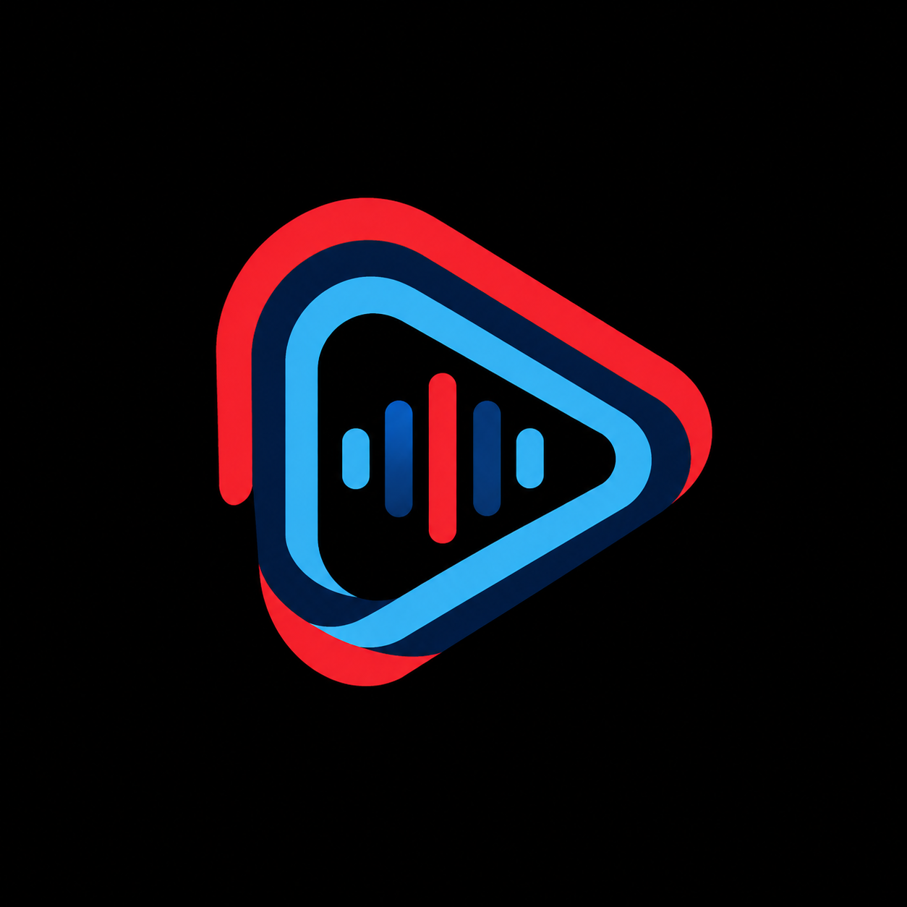

<div align="center">
  

# Play

Music haptics are available under Settings → Player → Music haptics (off by default). The beat/vocal PCM analyser and haptic controller are adapted from [LastWave-Native](https://github.com/Clash-Projects/LastWave-Native/tree/6c1ad72/app/src/main/java/com/lastwave/app/playback/haptics), under GPL-3.0. Choose Whole Song, Bass & Beats, or Vocals Only; adjust intensity, engine and battery-saver behavior. “Vocals Only” follows midrange emphasis rather than isolating a vocal stem. Automatic uses Precision DSP; native Android haptics depend on device support. Audio offload is suspended while haptics are enabled and restored from the saved preference when disabled. The muted crossfade standby never generates pulses.

An ad-free Android music client built with Kotlin and Jetpack Compose.
</div>

Play is a rebranded fork of [Velune](https://github.com/nikhilvishwakarma00/Velune), originally developed by Nikhil Vishwakarma. The original Git history, copyright notices, and GPL-3.0 license are preserved.

## Features

- Background playback, offline caching, and library management
- Synced lyrics, translation, and animated artwork
- Material You themes and audio controls
- Listening statistics and Music Together shared listening

In **Settings → Appearance → Lyrics**, choose an animation style and Left, Center, or Right text position. Both lyrics views honor these settings; the experimental view uses its fluid renderer for Apple Music style and the shared renderer for other styles. Automatic following resumes after manual scrolling, seeking, or re-enabling auto-scroll without waiting for the next line. Apple Music glides to the active line, while None follows without animation. Following requires timestamped lyrics. Lyrics position polling stops while the app is in the background, and duplicate/unrendered animation work has been removed.

## Download location

Open **Settings → Storage → Downloaded songs → Change location** to choose private phone storage, private SD-card storage (when a writable removable card is available), or a normal folder through Android's folder picker. New downloads use the selected location. Use **Move existing downloads** to move completed songs; original data is kept until each copy is saved. Normal-folder audio files retain their original audio format and can be opened in other players. Downloads briefly use phone storage while downloading before being saved to the chosen location. Keep enough temporary phone space for active downloads.

If a card or folder is unavailable, Play keeps the download in its previous location and shows an error in Storage settings. Restore access and use **Move existing downloads** to retry. Removing a download also removes the file Play saved; clearing all downloads never deletes unrelated folder contents.

This edition removes Discord, Last.fm/ListenBrainz integrations, Japanese/Korean lyric romanization, and the developer/donation/inspiration/community Discord cards. Original-language lyrics, lyric translation, and Music Together remain available.

The saved-download index initializes on an I/O thread rather than during screen/service construction. Download metadata registration also runs independently of the UI and is skipped when already recorded. Home and Library visual effects remain unchanged.

The optimized build uses Media3 and Guava’s bundled consumer rules rather than keeping their entire packages. R8 can remove unused library code and resources. The obsolete reflection-based offload helper, unused presence lifecycle dependency, and USB-exclusive/duplicate-preview paths from the haptics port have been removed.

The excluded `kizzy` and `lastfm` modules were also deleted from the source tree (26 files, 1,471 lines); they were already absent from the APK build graph.

## Build

Android source stays in `app/` and the Gradle modules. The native iOS source, supported features, limitations, and build instructions are in [ios/README.md](ios/README.md). GitHub Actions provides separate **Build Android** (optimized APK) and **Build iOS** (unsigned IPA) workflows. The iOS workflow generates its Xcode project, runs simulator unit tests, and archives for iOS 15 and newer. iPhone installation requires signing, for example with AltStore. For Android CI updates, configure `ANDROID_DEBUG_KEYSTORE_BASE64` with the existing debug keystore; without it, each clean runner creates a temporary signing key. Do not commit signing keys to Git.

Requires JDK 21, Android SDK 36, and Android Studio.

```sh
git clone https://github.com/highrise14752-a11y/play.git
cd play
./gradlew :app:assembleUniversalDebug
```

On Windows, use `gradlew.bat :app:assembleUniversalDebug`. Configure the Android SDK in your local `local.properties` file or through `ANDROID_HOME`. Optional integration keys are read from local properties or environment variables; see `app/build.gradle.kts`.

For daily use, build `./gradlew :app:assembleUniversalOptimized` (all CPU architectures) or `./gradlew :app:assembleArm64Optimized` (ARM64 phones). These enable the release optimizer and resource shrinking, disable debugging, and use the local debug signing key so they can update the earlier debug APK. Keep this key stable for future updates. Debug builds include development tooling and are unsuitable for comparing release size or performance.

Run `./gradlew :app:exportPlayApk` to write the installable file as `app/build/outputs/play/Play.apk`. In-app labels, including debug builds, use **Play**. New listening-session links use `play://`; older invitation links remain supported.

The Android application ID is `com.highrise14752.play`. No Play APK has been released yet. Updates will use [this repository's releases](https://github.com/highrise14752-a11y/play/releases). Some inherited online integrations still depend on upstream services and their configuration.

## Branding

The supplied Play artwork is stored in `assets/play-logo.png` and used for Android launcher icons, in-app branding, and store metadata. Historical screenshots may still show the upstream interface.

## Credits and license

Based on Velune and its upstream projects, including ArchiveTune, Metrolist, InnerTune, Kizzy, SimpMusic, and BetterLyrics. See the source headers and [GPL-3.0 license](LICENSE). Play is an independent client and is not affiliated with YouTube or Google.
